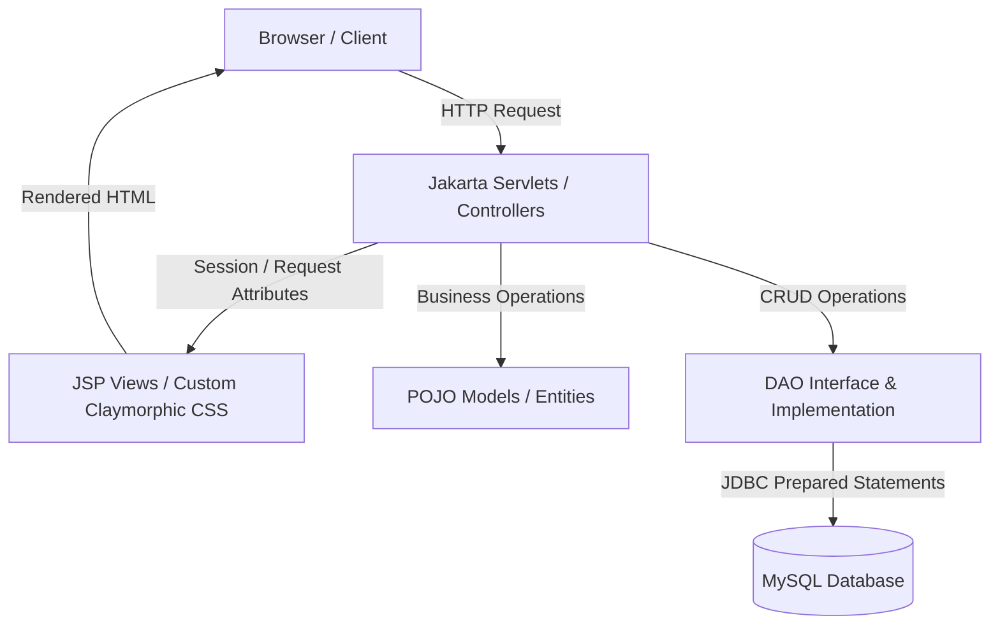
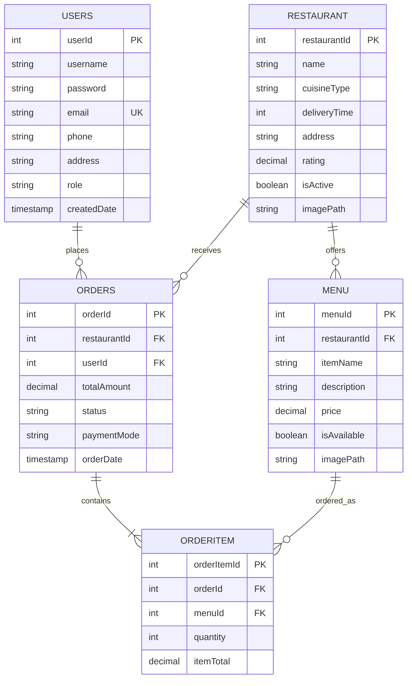

# 🍔 FlavorFleet - Online Food Ordering & Delivery Platform

[](https://www.oracle.com/java/)
[](https://jakarta.ee/)
[](https://tomcat.apache.org/)
[](https://www.mysql.com/)
[](https://www.mindrot.org/projects/jBCrypt/)

**FlavorFleet** is an enterprise-grade, full-stack food delivery web application built using **Java (Jakarta EE 10), Servlets, JSP, JDBC, and MySQL**. The platform delivers a seamless food discovery, cart ordering, and delivery experience crafted with a custom **Claymorphic & Glassmorphic UI design system**.

---

## 📸 Key Features

- **Split-Screen Showcases**: Distinct hero compositions for both **Sign Up** (Indian Feast) and **Sign In** (Wood-fired Pizza & Gourmet Burger).
- **Secure Authentication**: User registration and login protected with **salted jBCrypt password hashing** and SQL injection-resistant prepared statements.
- **Interactive Password Visibility Toggle**: Dynamic eye SVG toggle on password fields for enhanced usability.
- **Restaurant & Menu Catalog**: Dynamic listing of popular restaurants across Bengaluru with ratings, delivery estimates, cuisines, and categorized menus.
- **Smart Session Cart**: Fully featured cart supporting item addition, live quantity updates, price calculations, and multi-page session persistence.
- **Transactional Checkout**: Atomic order processing creating an order record and multiple line-item entries in a single database transaction.
- **Order Tracking & History**: Instant visual receipt on order confirmation along with complete historical order tracking.
- **User Profile Management**: View and manage customer profile details with auto-filling delivery addresses.

---

## 🏛️ System Architecture (MVC Pattern)

FlavorFleet follows the standard enterprise **Model-View-Controller (MVC)** design pattern combined with the **Data Access Object (DAO)** pattern:



### Architectural Layering
1. **Presentation Layer (View)**: Modular JSP files (`restaurant.jsp`, `menu.jsp`, `cart.jsp`, `login.jsp`, `register.jsp`, `checkout.jsp`, `order_confirmation.jsp`) sharing unified `<jsp:include>` components (`navbar.jsp`, `footer.jsp`).
2. **Controller Layer**: Jakarta HTTP Servlets routing actions (`LoginController`, `RegisterController`, `RestaurantController`, `MenuController`, `CartController`, `OrderController`, `LogoutController`).
3. **Business & Data Layer (Model & DAO)**: Encapsulated models (`User`, `Restaurant`, `Menu`, `Order`, `OrderItem`, `Cart`) and decoupled database access interfaces with implementations in `com.tap.daoImpl`.
4. **Persistence Layer**: Relational MySQL database managed via standard JDBC connection singleton (`DBConnection.java`).

---

## 🛠️ Technology Stack

| Layer | Technologies Used |
| :--- | :--- |
| **Backend Core** | Java SE 21 LTS, Jakarta EE 10 (Servlet 6.0 API, JSP) |
| **Server & Container** | Apache Tomcat 10.1 |
| **Database & Driver** | MySQL 8.0+ / 9.0+, MySQL Connector/J 9.2.0 |
| **Security & Hashing** | jBCrypt v0.4 (Salted One-Way Hash) |
| **Frontend UI** | HTML5, JSP Expression Language, Vanilla CSS3 (Claymorphism), Vanilla JavaScript |
| **IDE & Build** | Eclipse IDE for Enterprise Java (Dynamic Web Module 6.0) |

---

## 🗄️ Database Schema & Entities

The database schema is defined in [schema.sql](schema.sql):



---

## 🚀 Getting Started & Setup Guide

### 1. Prerequisites
- **JDK 21** or later installed and configured in your `JAVA_HOME`.
- **MySQL Server 8.0+** running locally on port `3306`.
- **Apache Tomcat 10.1** configured in your environment.
- **Eclipse IDE for Enterprise Java and Web Developers**.

### 2. Database Setup
1. Open MySQL Command Line or MySQL Workbench.
2. Run the provided database initialization script:
   ```sql
   SOURCE path/to/FlavorFleet/schema.sql;
   ```
3. Verify your database credentials in `src/main/java/com/tap/util/DBConnection.java`:
   ```java
   private static final String URL = "jdbc:mysql://localhost:3306/flavorfleet";
   private static final String USERNAME = "root";
   private static final String PASSWORD = "root"; // Update to your local MySQL password
   ```

### 3. Import & Run in Eclipse
1. Open Eclipse IDE.
2. Click **File** &rarr; **Import...** &rarr; **General** &rarr; **Existing Projects into Workspace**.
3. Select the `FlavorFleet` root directory and click **Finish**.
4. Configure Apache Tomcat 10.1 runtime if prompted:
   - Right-click project &rarr; **Properties** &rarr; **Targeted Runtimes** &rarr; Check **Apache Tomcat v10.1**.
5. Right-click project &rarr; **Run As** &rarr; **Run on Server** (Select Apache Tomcat 10.1).
6. Open your browser and navigate to:
   ```
   http://localhost:8081/FlavorFleet/restaurant
   ```

---

## 🔑 Demo Login Credentials

The seed database comes pre-loaded with verified demo accounts (passwords hashed with BCrypt):

| Role | Email Address | Password |
| :--- | :--- | :--- |
| **Customer** | `john@example.com` | `password123` |
| **Admin** | `admin@flavorfleet.com` | `password123` |

*(You can also register a brand new account on the [Sign Up](http://localhost:8081/FlavorFleet/register.jsp) page).*

---

## 📂 Project Directory Structure

```text
FlavorFleet/
├── .gitignore                      # Git exclusion rules
├── schema.sql                      # Complete MySQL database schema & seed records
├── README.md                       # Project documentation
├── .project / .classpath           # Eclipse project configuration
└── src/
    └── main/
        ├── java/
        │   └── com/tap/
        │       ├── controller/     # Jakarta HTTP Servlets (Login, Register, Cart, Orders, etc.)
        │       ├── dao/            # Data Access Object Interfaces
        │       ├── daoImpl/        # JDBC DAO Implementations with PreparedStatement queries
        │       ├── model/          # POJO Entity classes (User, Restaurant, Menu, Order, Cart)
        │       └── util/           # DBConnection singleton & test utilities
        └── webapp/
            ├── css/
            │   └── style.css       # Master claymorphic stylesheet
            ├── images/             # Static hero banners, restaurant & food photography
            ├── WEB-INF/
            │   ├── lib/            # Dependency JARs (mysql-connector-j, jbcrypt)
            │   └── web.xml         # Servlet mappings & deployment descriptor
            ├── navbar.jsp          # Reusable header component
            ├── footer.jsp          # Reusable footer component
            ├── restaurant.jsp      # Home & Restaurant showcase page
            ├── menu.jsp            # Restaurant menu item listing
            ├── cart.jsp            # Shopping bag & quantity editor
            ├── checkout.jsp        # Order review & delivery details
            ├── order_confirmation.jsp # Visual order receipt & summary
            ├── orders.jsp          # Past order history page
            ├── login.jsp           # Split-screen sign in page
            ├── register.jsp        # Split-screen user registration page
            └── profile.jsp         # Customer profile management
```

---

## 👨‍💻 Author & Acknowledgments
- Developed by **Sairajiv** as an Advanced Java Full-Stack Application.
- Built using principles taught in **Tap Academy** Advanced Java curriculum.
